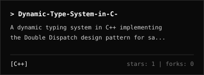
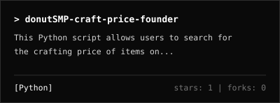
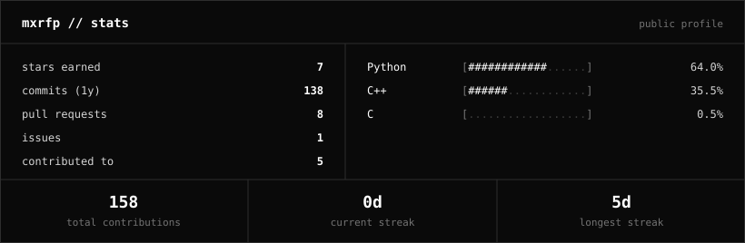
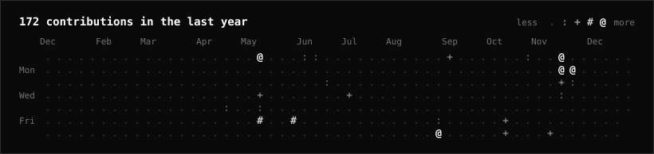

<!-- Banner -->

  

### About

- 15 y/o, programming as a hobby
- Interested in language design, memory management, and functional programming
- Building tools, experiments, and side projects 

---

### Languages

  
  &nbsp;&nbsp;
  
  &nbsp;&nbsp;
  
  &nbsp;&nbsp;
  

---

### Projects

  <a href="https://github.com/mxrfp/Dynamic-Type-System-in-C-">
    <picture>
      <source media="(prefers-color-scheme: dark)" srcset="https://raw.githubusercontent.com/mxrfp/mxrfp/output/repo-Dynamic-Type-System-in-C--dark.svg" />
      <source media="(prefers-color-scheme: light)" srcset="https://raw.githubusercontent.com/mxrfp/mxrfp/output/repo-Dynamic-Type-System-in-C--light.svg" />
      
    </picture>
  </a>
  <a href="https://github.com/mxrfp/donutSMP-craft-price-founder">
    <picture>
      <source media="(prefers-color-scheme: dark)" srcset="https://raw.githubusercontent.com/mxrfp/mxrfp/output/repo-donutSMP-craft-price-founder-dark.svg" />
      <source media="(prefers-color-scheme: light)" srcset="https://raw.githubusercontent.com/mxrfp/mxrfp/output/repo-donutSMP-craft-price-founder-light.svg" />
      
    </picture>
  </a>

---

### Stats

  <picture>
    <source media="(prefers-color-scheme: dark)" srcset="https://raw.githubusercontent.com/mxrfp/mxrfp/output/stats-ascii-dark.svg" />
    <source media="(prefers-color-scheme: light)" srcset="https://raw.githubusercontent.com/mxrfp/mxrfp/output/stats-ascii-light.svg" />
    
  </picture>

---

### Contributions

  <picture>
    <source media="(prefers-color-scheme: dark)" srcset="https://raw.githubusercontent.com/mxrfp/mxrfp/output/contributions-ascii-dark.svg" />
    <source media="(prefers-color-scheme: light)" srcset="https://raw.githubusercontent.com/mxrfp/mxrfp/output/contributions-ascii-light.svg" />
    
  </picture>

